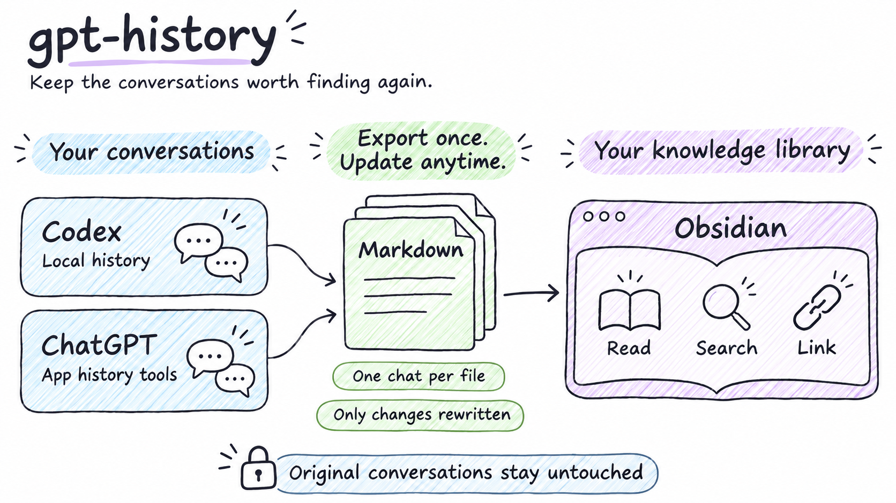
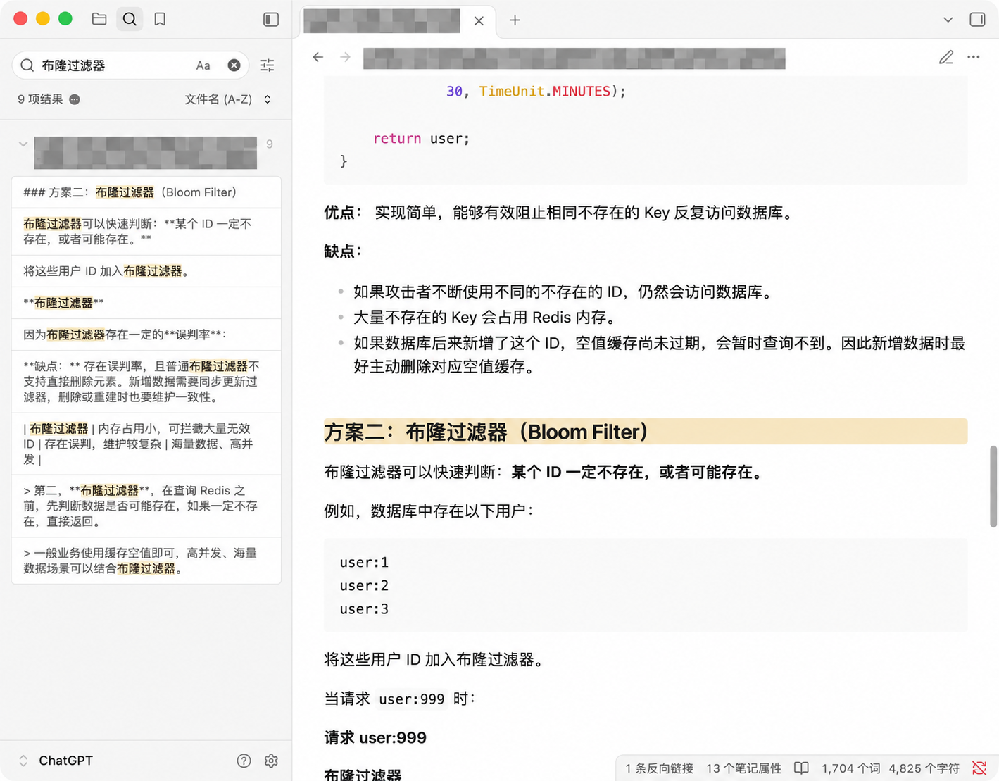

# gpt-history

[中文](README.md) · **English**

Export Codex and ChatGPT conversations to Markdown. Read, search, and organize them in Obsidian.

## Why this exists

Useful code, explanations, and ideas get buried in chat lists. Finding them weeks later often means scrolling through old conversations.

gpt-history saves them as files you own: one note per conversation, with a date, title, source, and navigation index. Keep using them when you change editors, collect research, or add your own notes.

## Quick start

Clone or download this repository. Open its directory in Codex, Claude Code, or another agent with local file access. Paste this prompt:

~~~text
Use gpt-history in this repository to export my AI conversations.
Read README.en.md first. Check Python 3.9+, read access to the history
directories, and whether zstd is available.
Inspect CODEX_HOME and ~/.codex without changing them. Export 3 samples
to a temporary directory outside this repository.
Check user messages, assistant replies, order, and code blocks. Then export
all Codex history to ~/Documents/AI-Chat-Backup/Codex/.
Run it again to verify incremental updates.

If this environment exposes the Codex desktop ChatGPT history tools,
follow CHATGPT_EXPORT.md and export to ~/Documents/AI-Chat-Backup/ChatGPT/.
If those tools are unavailable, explain that and finish the Codex export.
Do not read passwords or cookies.

Do not modify or delete source conversations. Do not upload chat data.
If you can control Obsidian, open the backup and test navigation,
full-text search, and property filters.
Report the export count, destination, and any missing content.
~~~

**Claude Code can run the local exporter. Collecting ChatGPT history requires specific Codex desktop tools.** Exporting Claude Code's own history is not supported.

## Preview

Search the conversation body in Obsidian and jump straight to a matching passage. Headings, lists, and code blocks remain Markdown.

*Captured in the real Obsidian app, then redacted with an image tool. Conversation dates, titles, and IDs are covered. The technical text demonstrates the reading experience.*

Dates, source paths, and archive status appear as note properties. Search the body or filter ChatGPT notes:

~~~text
[archived:true]
tag:#chatgpt
~~~

## Run manually

Requires Python 3.9+. No third-party Python dependencies. Compressed history also requires zstd.

~~~bash
# macOS: needed only for .zst files if zstd is not installed
brew install zstd

# Run from the repository root
python3 codex_export.py

# Discover sources, or export a small sample first
python3 codex_export.py --discover
python3 codex_export.py --sample 3 --output ~/Documents/AI-Chat-Sample

# Choose a source, destination, and display timezone
python3 codex_export.py --source ~/.codex \
  --output ~/Documents/AI-Chat-Backup/Codex --timezone UTC

# ChatGPT: convert previously collected local snapshots
python3 codex_export.py --chatgpt --timezone UTC
~~~

The last command **does not fetch new cloud messages**. See the bilingual [ChatGPT guide](CHATGPT_EXPORT.md) for collection and refresh instructions.

Exit code 0 means success. For exit code 1, inspect export-report.json in the output directory. Some sources may be missing while other conversations were exported successfully. In Codex reports, database_missing_ids lists missing sources and errors lists read or conversion failures.

## Output

~~~text
~/Documents/AI-Chat-Backup/
├── Codex/
│   ├── date title [conversation-id].md
│   └── index.md
├── ChatGPT/
│   ├── date title [conversation-id].md
│   ├── attachments/
│   └── index.md
└── .chatgpt-source/             # Private source snapshots
~~~

- YAML properties, message roles, timestamps, and source references.
- Only changed files are rewritten on subsequent runs.
- Missing or damaged sources do not replace a previous complete backup.
- Local edits are saved under .local-edits before an update replaces them.
- Tool events and internal reasoning stay out of the dialogue. Branches, retractions, and missing content are labeled.

Keep personal annotations in separate notes linked to a conversation.

## Compatibility

| Area | Support |
| --- | --- |
| OS | Tested on macOS; Linux may work but has not been tested on a real machine; native Windows is unsupported |
| Codex | Local JSONL, compressed history, archives, subagents, and recoverable fork history |
| ChatGPT | Visible messages returned by the app's history tools; requires those tools in your environment |
| Attachments | ChatGPT copies returned files that are readable locally; Codex keeps references or placeholders |
| Branches and rich content | Unavailable branches are not invented; unresolved citations and widgets are labeled |

No account credentials are read. Codex export and snapshot conversion run locally. ChatGPT collection reads account history through the app's tools. Generated navigation and annotations currently use Chinese; original message text is preserved.

## Privacy and public repositories

**Share the tool; keep your conversation backups private.** Exports retain original text, conversation IDs, and source paths. The exporter does not automatically redact conversation content.

Real validation samples have been removed from this repository. Personal paths are resolved dynamically. Public screenshots have identifiers covered. Ignore rules exclude common histories, credentials, output folders, and Obsidian settings.

Before publishing, run:

~~~bash
python3 scripts/check_public_tree.py
~~~

The check scans files Git would include. It flags suspicious paths, credential patterns, and private artifacts without printing secret values. Review new screenshots visually. See [PRIVACY.md](PRIVACY.md) for the audit scope.

## Development

~~~bash
python3 -m unittest discover -s tests -v
node tests/test_collector.js
~~~

Node.js is only needed for collector tests. Include a small, redacted reproduction when reporting a bug. Do not submit full histories, credentials, or personal attachments.

See [VALIDATION.md](VALIDATION.md) for implementation checks and limits.

## License

Code is available under the [MIT License](LICENSE).
