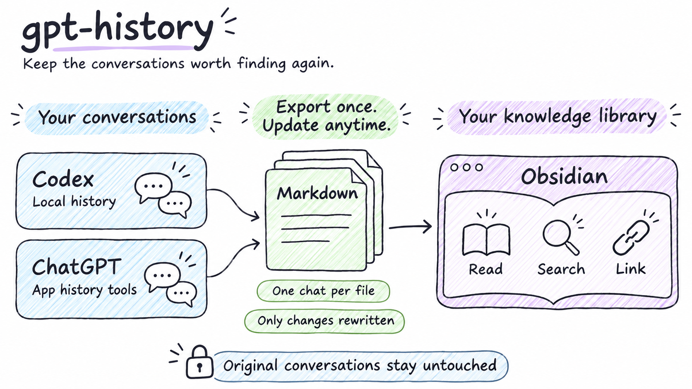
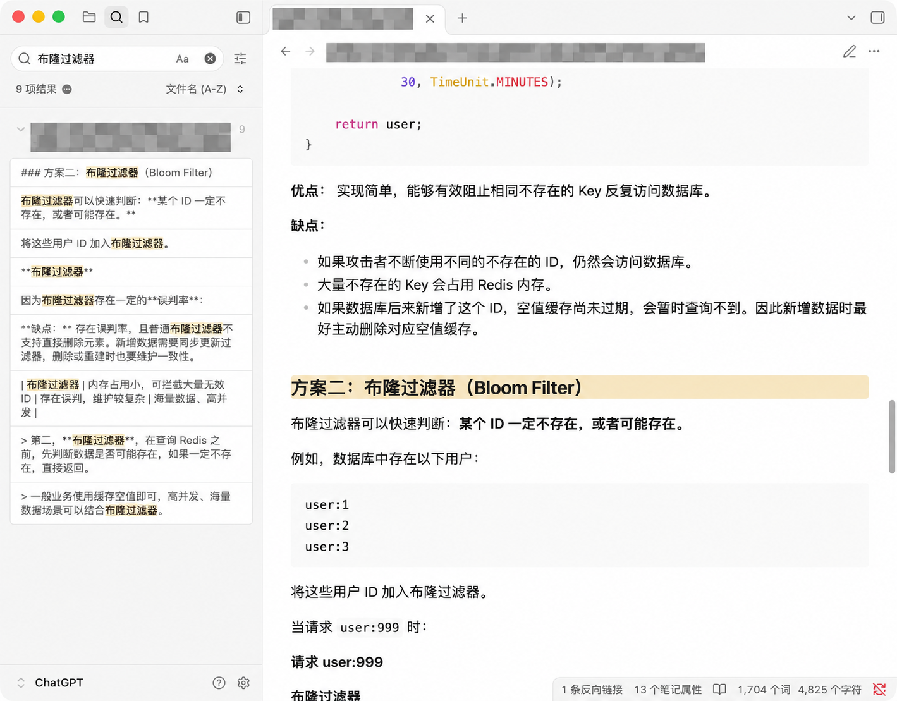

# gpt-history

**中文** · [English](README.en.md)

把 Codex 和 ChatGPT 历史会话变成 Markdown，在 Obsidian 中阅读、搜索和整理。

## 为什么做这个项目

有用的代码、解释和思考，常常留在聊天列表里。过几周再找，得重新翻一遍。

gpt-history 把它们保存为自己的文件：一个会话一篇笔记，带日期、标题、来源和导航索引。以后换编辑器、整理专题或补充批注，都能继续使用。

## 快速开始

先克隆或下载本仓库，在项目目录中打开 Codex、Claude Code 等能读写本地文件的 Agent，复制下面这段话：

~~~text
请使用当前仓库的 gpt-history 导出我的 AI 历史会话。
先阅读 README.md，检查 Python 3.9+、历史目录的读取权限和 zstd 是否可用。
只读检查 CODEX_HOME 与 ~/.codex，先导出 3 个样本到仓库外的临时目录。
确认用户消息、Assistant 回复、顺序和代码块正确，再全量导出到
~/Documents/AI-Chat-Backup/Codex/，最后复跑一次验证增量更新。

如果当前环境提供 Codex 桌面应用的 ChatGPT 历史工具，
按 CHATGPT_EXPORT.md 采集并导出到 ~/Documents/AI-Chat-Backup/ChatGPT/。
如果没有这些工具，明确说明，继续完成 Codex 导出；不要读取密码或 Cookie。

不要修改或删除原始会话，不要上传聊天记录。
若可以操作 Obsidian，打开备份目录，验证索引、正文搜索和属性筛选。
最后告诉我导出数量、保存位置及缺失内容。
~~~

**Claude Code 可以运行本地导出器。ChatGPT 云端采集需要特定的 Codex 桌面工具。** 本项目暂不导出 Claude Code 自身的历史。

## 示例效果

在 Obsidian 中搜索正文，点击结果即可跳到对应段落。标题、列表和代码块保留 Markdown 格式。

*实际 Obsidian 截图，经图像工具添加马赛克；会话日期、标题和 ID 已遮盖。截图中的技术正文仅用于展示阅读效果。*

会话的日期、来源、归档状态会显示为笔记属性。可以搜索正文，也可以用下面的条件筛选 ChatGPT 笔记：

~~~text
[archived:true]
tag:#chatgpt
~~~

## 手动运行

需要 Python 3.9+。Python 部分没有第三方依赖。读取压缩历史另需 zstd。

~~~bash
# macOS：仅在需要读取 .zst 且尚未安装时
brew install zstd

# 在仓库根目录运行
python3 codex_export.py

# 先看来源，或只导出样本
python3 codex_export.py --discover
python3 codex_export.py --sample 3 --output ~/Documents/AI-Chat-Sample

# 自定义来源、输出与时区
python3 codex_export.py --source ~/.codex \
  --output ~/Documents/AI-Chat-Backup/Codex --timezone Asia/Shanghai

# ChatGPT：将已经采集的本地快照转换为 Markdown
python3 codex_export.py --chatgpt
~~~

最后一条命令**不会拉取云端新消息**。首次采集与后续刷新见 [ChatGPT 使用说明](CHATGPT_EXPORT.md)。

退出码为 0 表示成功。退出码为 1 时，检查输出目录的 export-report.json：可能是部分来源缺失，其他会话仍已正常导出。Codex 报告中的 database_missing_ids 列出缺源会话，errors 列出读取或转换错误。

## 导出内容

~~~text
~/Documents/AI-Chat-Backup/
├── Codex/
│   ├── 日期 标题 [会话ID].md
│   └── index.md
├── ChatGPT/
│   ├── 日期 标题 [会话ID].md
│   ├── attachments/
│   └── index.md
└── .chatgpt-source/             # 私有来源快照
~~~

- 每篇笔记带 YAML 属性、消息角色、时间和来源。
- 再次运行只更新有变化的文件。
- 来源丢失或损坏时，保留已有的完整备份。
- 更新前发现手工修改，会把旧内容保存到备份目录的 .local-edits。
- 工具事件和内部推理不混入对话；分支、撤回与缺失内容明确标记。

个人批注建议另建笔记，再链接到会话。

## 支持范围

| 项目 | 当前支持 |
| --- | --- |
| 系统 | macOS 已实测；Linux 可尝试，未实机验证；Windows 原生暂不支持 |
| Codex | 本机 JSONL、压缩历史、归档、子代理与可恢复的分叉历史 |
| ChatGPT | 应用历史工具返回的可见消息；需当前环境提供对应接口 |
| 附件 | ChatGPT 复制接口返回且本机可读的附件；Codex 保留引用或占位 |
| 分支与富文本 | 未返回的分支不补写；缺失的引用网址和交互内容注明原因 |

工具不读取账户凭证。Codex 导出与快照转换均在本地执行；ChatGPT 采集通过应用接口读取账号历史。

## 隐私与公开仓库

**可以分享工具代码，聊天备份默认应保持私有。** 导出器保留原文、会话 ID 和来源路径，不会自动脱敏聊天正文。

本仓库的真实验收样本已移出，个人路径已改为动态路径。公开截图已遮盖身份信息。忽略规则排除了常见的原始历史、凭证、导出目录和 Obsidian 配置。

发布前运行：

~~~bash
python3 scripts/check_public_tree.py
~~~

它检查 Git 将纳入的文件，报告可疑路径、密钥格式和私有产物，不打印命中的秘密值。新增截图仍需目视检查。范围与结果见 [隐私检查记录](PRIVACY.md)。

## 开发与反馈

~~~bash
python3 -m unittest discover -s tests -v
node tests/test_collector.js
~~~

Node.js 只用于采集器测试。报告问题时提供脱敏后的最小样本；不要提交整份历史、凭证或个人附件。

实现细节与验证范围见 [VALIDATION.md](VALIDATION.md)。

## 许可

代码采用 [MIT License](LICENSE)。
